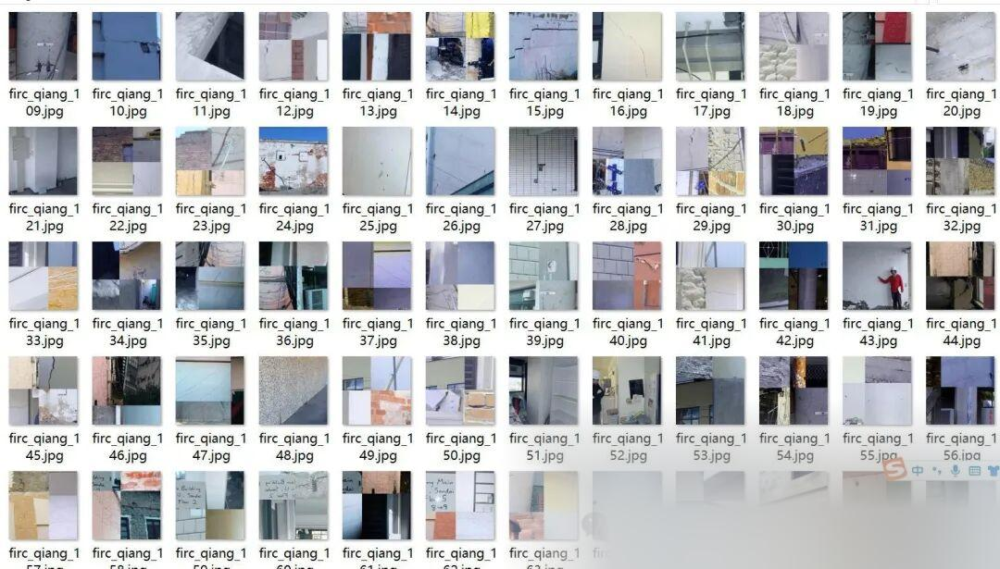
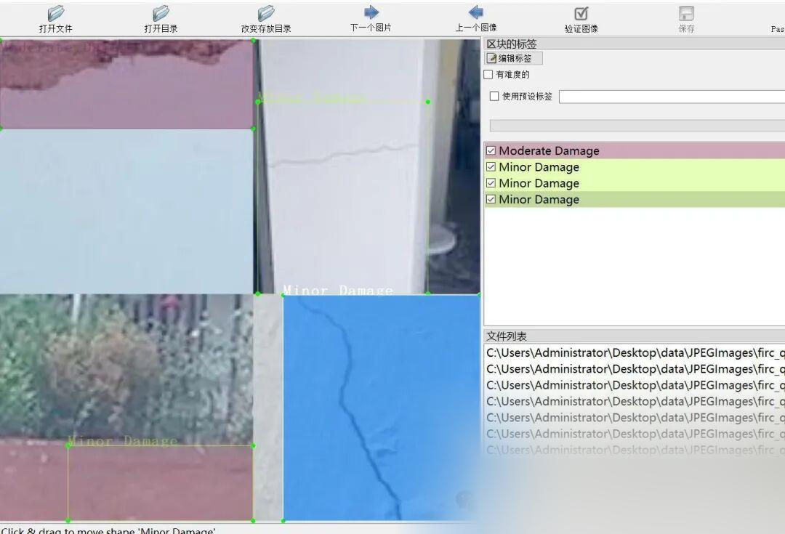

# [Dataset] [Object Detection] Wall Wall Damage Level Detection Dataset VOC+YOLO format 4629 images in 4 categories

Important Notice: Some of the datasets are enhanced, meaning they consist of four images stitched together into one. Please review the image preview to confirm compliance before downloading.

Dataset format: Pascal VOC format + YOLO format (txt file without split path, only containing jpg images and corresponding VOC format xml files and yolo format txt files)

Number of images (number of jpg files): 4629

Number of annotations (number of xml files): 4629

Number of annotations (number of txt files): 4629

Labeling category count: 4

Annotation Category Name: ["Heavy Damage", "Minor Damage", "Moderate Damage", "Undamage"]

Number of boxes labeled in each category:

Heavy Damage Frames = 2052

Minor Damage Frames = 6475

Moderate Damage Frames = 4094

Undamaged Frame Count = 742

Total frame count: 13363

Using labelImg:

Annotation rules: Draw a rectangle around the category.

Important Notice: No

Special : This dataset does not guarantee the accuracy or precision of the trained models or weight files. The dataset is provided with accurate and reasonable annotations only.

Image Preview:

Annotation example:

## Payment

Here is a pay link on Stripe ( https://buy.stripe.com/3cs8yP7sY87d0vu9AB ). Please contact me lonlonago@foxmail.com after funding $89, and I will send you a complete data files , thank you!

